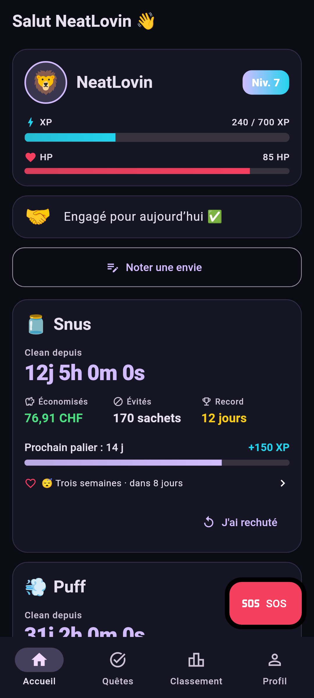
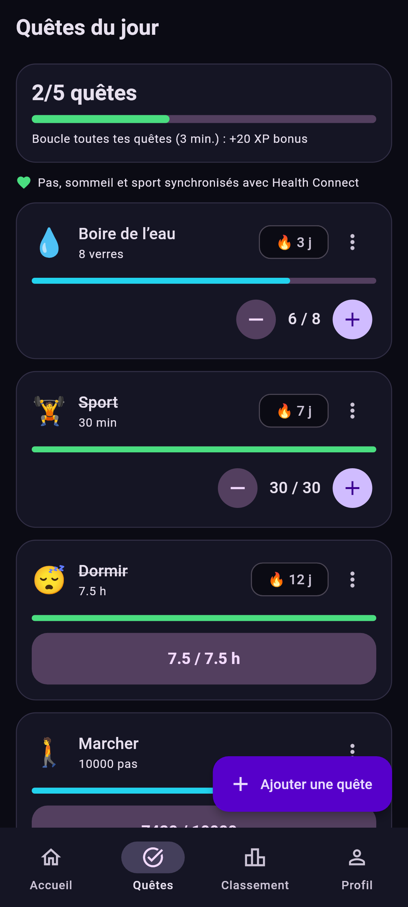
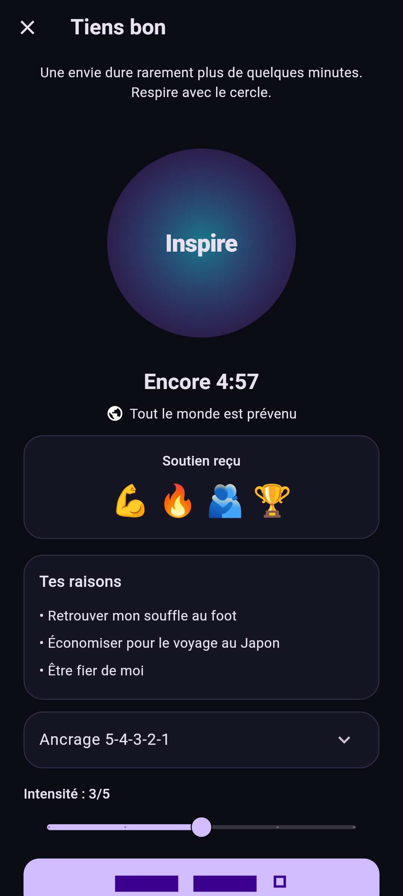
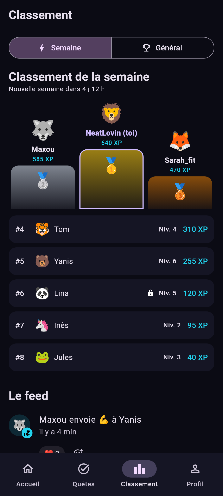
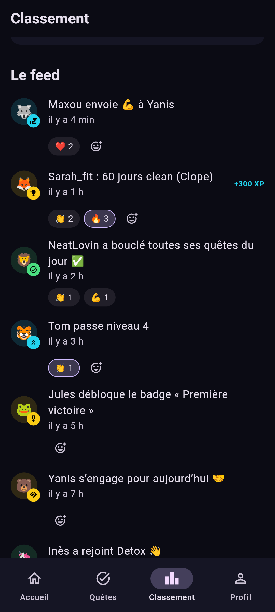
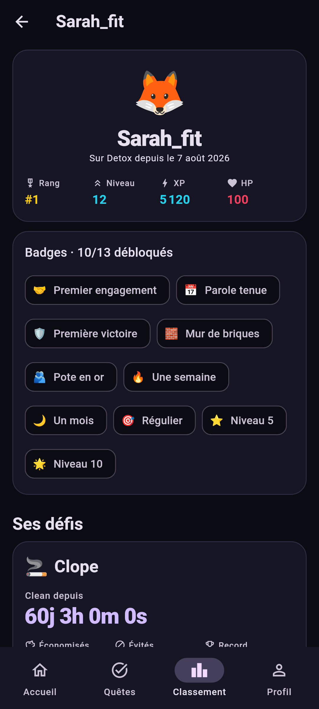
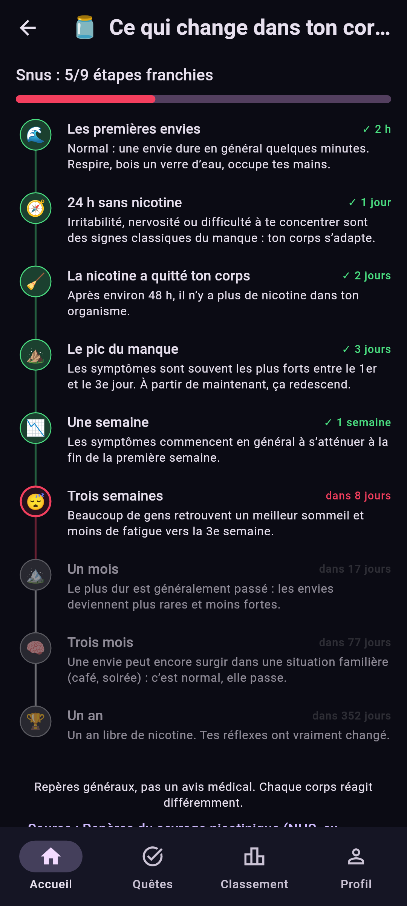

# detox
Gamified Flutter app to quit addictions and build healthy habits — with a public leaderboard.

> **Detox** — arrête avec tes potes. Level up chaque jour.

Une app mobile pour décrocher du porno, du snus, de la clope, de la beuh, du sucre, de l'alcool… et tenir un bon rythme de vie. Chaque jour clean, chaque envie résistée, chaque quête bouclée rapporte de l'XP. Tout le monde voit le classement général et les profils publics des autres. Une rechute coûte des HP, **jamais** d'XP ni de niveau : on repart.

## Captures

<table>
  <tr>
    <th>Accueil</th><th>Quêtes du jour</th><th>SOS</th>
  </tr>
  <tr>
    <td></td>
    <td></td>
    <td></td>
  </tr>
  <tr>
    <th>Classement de la semaine</th><th>Feed et réactions</th><th>Profil d'un joueur</th>
  </tr>
  <tr>
    <td></td>
    <td></td>
    <td></td>
  </tr>
  <tr>
    <th>Ce qui change dans ton corps</th><th></th><th></th>
  </tr>
  <tr>
    <td></td>
    <td></td><td></td>
  </tr>
</table>

<sub>Rendus par la CI à partir des vrais écrans avec des joueurs fictifs (workflow <code>Screenshots</code>, test <code>test/screenshots</code>).</sub>

## Fonctionnalités

- **Connexion** par email + code à 6 chiffres
- **Onboarding** : pseudo, avatar, addictions suivies (catalogue + perso, option « privée »), quêtes du jour, préférences et motivations
- **Accueil** : carte joueur (niveau, XP, HP), engagement du matin, timer live par addiction, CHF économisés, record, prochain palier, bouton **SOS**, « Noter une envie »
- **SOS** : 5 min de respiration guidée, raisons perso, ancrage 5-4-3-2-1, soutiens des autres joueurs en direct
- **Journal des envies** : intensité, déclencheur, part des envies résistées
- **Quêtes du jour** : eau, sport, sommeil, pas, méditation, lecture, sans écran, perso ; séries et bonus « journée bouclée » ; pas, sommeil et sport remplis via **Health Connect**
- **Ce qui change dans ton corps** : étapes santé par addiction (sources citées), avec compte à rebours vers la prochaine
- **Classement de la semaine** (XP gagnée depuis lundi, le gagnant est annoncé chaque lundi) et **classement général** (XP total)
- **Feed global** temps réel avec **réactions** (👏 🔥 💪 ❤️ 😂 ; seulement 💪 ❤️ sur une rechute ou un SOS) ; profils publics : rang, niveau, XP, HP, badges, addictions non privées
- **Profil privé** : reste dans le classement (pseudo, niveau, XP), mais profil, feed et SOS invisibles pour les autres
- **Stats** : jours clean, meilleure série, XP et quêtes bouclées sur la période, moments à risque des envies
- **Notifications push** : SOS des autres, soutiens reçus, rappels à 9 h (engagement) et 20 h (quêtes restantes)
- **Paramètres** : confidentialité, notifications, suppression du compte (effacement complet côté serveur), don TWINT
- **13 badges**, rechute en 2 taps : elle coûte des HP, jamais d'XP (le nom d'une addiction privée ne sort jamais)
- **Mises à jour dans l'app** : chaque build de `main` est proposé directement aux joueurs
- **Remontée des plantages** : les erreurs inattendues de l'app sont regroupées dans Supabase (30 jours) et lisibles via le workflow `Supabase db push`, mode `errors-log`

Toute la gamification (XP, HP, niveaux, paliers, badges, feed) est calculée **côté serveur** par des fonctions et triggers Postgres, avec des plafonds journaliers anti-farming.

## Stack

Flutter (Android + iOS) · Dart 3 · Riverpod (codegen) · go_router · freezed / json_serializable · Supabase (Auth OTP, Postgres + RLS, Realtime, pg_cron, Edge Functions, Storage) · Firebase Cloud Messaging · Health Connect · flutter_animate · Material 3 (thème sombre)

## Structure

```
lib/
├── main.dart, app.dart
├── core/           env, client Supabase, router, thème, l10n, session, utils
├── features/
│   ├── auth/         domain · data · presentation
│   ├── onboarding/
│   ├── community/    classement, feed, profils joueurs
│   ├── cravings/
│   ├── quests/
│   ├── sos/
│   ├── addictions/
│   ├── gamification/
│   ├── health/       Health Connect
│   ├── health_timeline/
│   ├── notifications/
│   ├── profile/
│   ├── settings/
│   ├── stats/
│   └── updates/      mises à jour dans l'app
└── shared/         widgets communs (XpBar, HpBar, StatTile, EmptyState…)

supabase/
├── migrations/     schéma, fonctions de gamification, RLS / grants / realtime / cron
├── functions/push/ envoi FCM (Edge Function)
├── seed.sql        3 users fictifs pour le dev local
└── templates/      email OTP
```

Règles du projet : voir [`CLAUDE.md`](CLAUDE.md). Mise en route (Supabase, Android, iOS) : voir [`SETUP.md`](SETUP.md).

## Commandes

```bash
flutter pub get
dart run build_runner build -d          # codegen (freezed, riverpod, json)
flutter analyze && dart analyze         # dart analyze exécute riverpod_lint
flutter test
flutter run --dart-define-from-file=env.json

supabase start && supabase db reset     # DB locale + seed (Docker requis)
tool/sql_tests/run.sh                   # tests SQL anti-triche (Postgres local, vars PG*)
```

## Roadmap

- **V1 — Tenir le coup** ✅ : SOS, journal des envies, quêtes du jour, engagement du matin, badges, classement général.
- **V2 — Hygiène de vie** ✅ : notifications push, Health Connect, stats, timeline santé, paramètres et suppression de compte.
- **V3 — Défis et garde-fous** : défis entre joueurs, mode réduction progressive, version iPhone (HealthKit), offline-first.

## Licence

[MIT](LICENSE.md) © 2026 Valentino Di Donato (NeatLovin).

---

<p align="center"><br><sub>Développé par <a href="https://github.com/NeatLovin">NeatLovin</a></sub></p>
